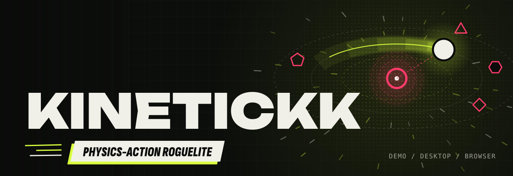
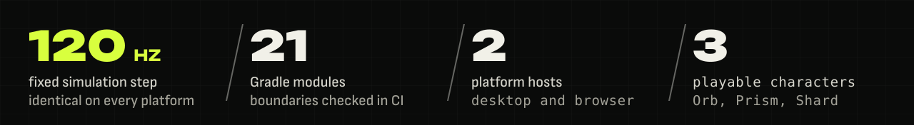
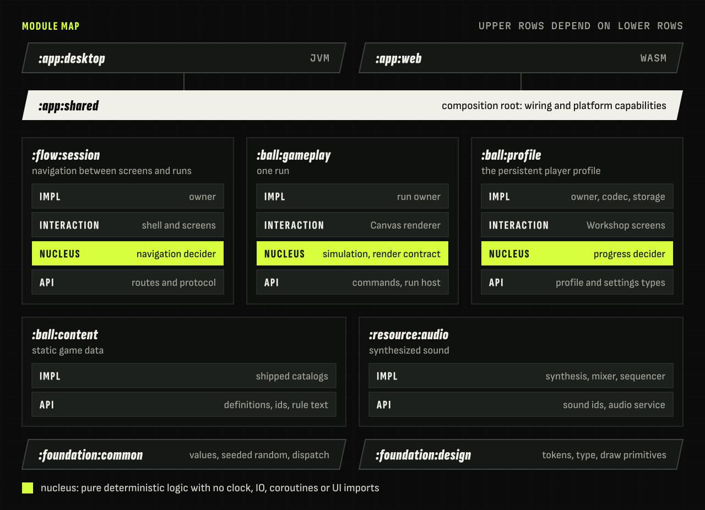
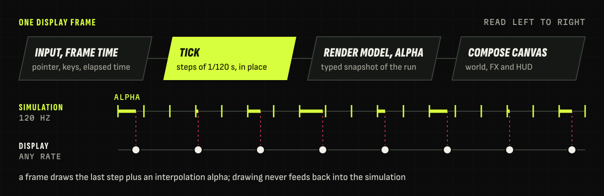

<!-- SPDX-FileCopyrightText: 2026 Vladislav Tomilov -->
<!-- SPDX-License-Identifier: PolyForm-Noncommercial-1.0.0 -->

  

  
  
  

  
  
  

<h1 align="center">KINETICKK Demo</h1>

KINETICKK is a physics-action roguelite. Your pointer pulls the Core toward it. Steer around hazards, build speed to hit enemies, and pick up items that change how the Core fights.

Play as Circle (Orb), Square (Prism), or Triangle (Shard). Circle is available from the start. Defeat three elites across runs to unlock Square, and land twenty Dash hits to unlock Triangle. There is no run limit. The demo includes all 135 items available through the Architect fight.

Defeating the Architect completes the run. You can play again or return to the menu and spend the Matter you earned in the Workshop. Refit and Honing have three levels per character or weapon. Each of the eight Core Matrix nodes has two ranks. Reborn progression requires the full game.

  

## How it is built

The browser and desktop hosts share a Kotlin Multiplatform codebase built with Gradle. The browser compiles to Kotlin/Wasm. Desktop runs on the JVM. Both use Compose Multiplatform for the interface.

  

- The [gameplay nucleus](ball/gameplay/nucleus) advances the run in fixed steps at 120 Hz of simulation time. It owns motion, combat, encounters, and rewards. Seeded randomness keeps the same run inputs reproducible.
- The [profile nucleus](ball/profile/nucleus) applies Matter purchases and keeps progression within the demo's implemented tiers. The [session nucleus](flow/session/nucleus) coordinates menus, overlays, and the run lifecycle.
- The [graphics engine](ball/gameplay/interaction) reads the gameplay render model and cues. Compose Canvas draws the world, effects, and HUD, interpolating motion between simulation steps. Menus share the [design primitives](foundation/design). The [audio service](resource/audio) synthesizes music and effects at runtime.

The [app composition](app/shared) connects these pieces to platform input, display, audio, and local storage.

  

## Privacy

The demo saves preferences and progression locally in your browser or desktop account. It uses separate storage from the full game. The game code sends no gameplay telemetry.

## License

Original demo source, game content, assets, and their copies in distributed demo builds are available under the [PolyForm Noncommercial License 1.0.0](LICENSE). Its terms permit noncommercial use, modification, and redistribution with the required notices. The [NOTICE](NOTICE) explains coverage and attribution. [Third-party components and fonts](LICENSES/README.md) retain their own licenses.
